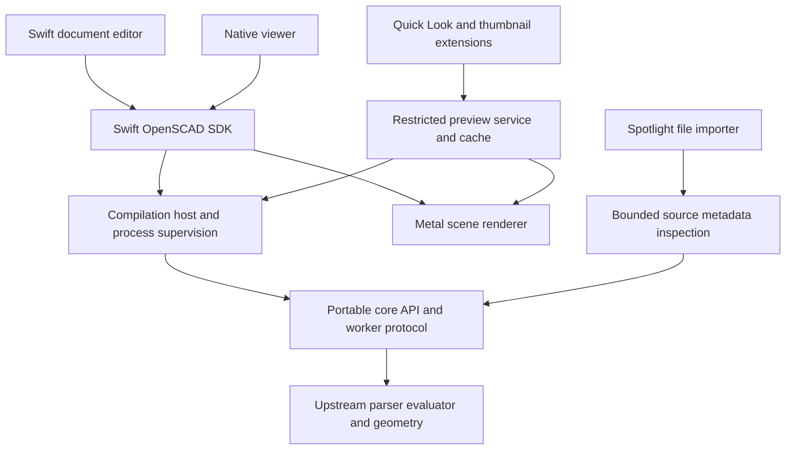

# OpenSCAD native macOS implementation plan

Status: proposed delivery plan, 19 October 2026. This plan authorizes no new implementation or release by itself.

Reimplement the Qt application's complete supported user experience in Swift, SwiftUI, AppKit and Metal. Retain the upstream OpenSCAD language and geometry implementation in a portable C++ core repository. The native app, helpers and system extensions must have no Qt dependency. Preserve ordinary `.scad` source compatibility and distinguish fast preview from evaluated rendering throughout the product.

## Scope and parity baseline

Use the inherited Qt sources at upstream commit `7bbf603833e167712e9cc7ae3432001dc26817d0` as the initial reference. The current core pin is `51f9cfe870f2599a1fd0626159279ef5101ba609`. Freeze a reference Qt build, its enabled backends, optional dependencies, feature flags, examples, fonts and regression corpus. Rebaseline later upstream changes through explicit compatibility work rather than chasing a moving master branch. The reference profile must include normal upstream desktop capabilities even when the current prototype disabled their dependencies, such as 3MF; do not choose a reduced reference build merely to avoid porting features.

Produce an exhaustive parity ledger from MainWindow actions, dynamically constructed menus, preferences, dialogs, editor commands, Customizer, import/export dispatch, command-line options and enabled optional features. Each row records reference behavior, implementation issue, native equivalent, test fixture, acceptance evidence and remaining differences. Menu labels alone are insufficient: verify shortcuts, error cases, file mutations and rendering behavior.

"Complete" means every applicable baseline row is implemented and accepted or has an explicitly approved exception. Optional or experimental Python, AI, device input and service integrations remain visible in the ledger; they cannot disappear silently to justify a parity claim. Platform-specific Qt implementation details need a native equivalent rather than literal UI duplication.

The current prototype supplies native document windows and recovery handling, compilation isolation, basic Metal CSG preview and local packaging. It does not establish full preview, editor, export or system-extension parity. Its 64-leaf, 127-node and 128-ray-event limits must not become production compatibility limits.

## Repository and ownership boundary

| Repository | Responsibilities | Exclusions |
| --- | --- | --- |
| `dalbrecht/openscad-core` | Upstream history, language/parser/evaluator, geometry backends, import/export, Customizer semantics, diagnostics/source mapping, portable embedding API, CLI/worker, upstream and adapter tests | SwiftUI, AppKit, Metal, Qt linkage in native targets, macOS document or extension lifecycle, application network/service UI |
| `dalbrecht/openscad-apple` | Swift SDK, document model and editor, SwiftUI scenes, narrow AppKit text-system bridges, Metal rendering, worker/XPC adapters, Quick Look and Spotlight products, app packaging and native tests | A second parser/evaluator/geometry engine, copied core implementation, Qt/QScintilla/OpenCSG runtime dependencies |

Keep inherited Qt and OpenGL reference sources available in the core fork but outside all native build targets. Separate application service code such as AI/network adapters from the native engine target even where upstream's source grouping currently mixes them. Preserve licenses and inherited formatting; do not mass-rewrite upstream C++ in Swift.

CMake remains the core build authority. SwiftPM remains the Apple source/build declaration where practical, with reproducible bundle/extension staging scripts. If extension packaging requires an Xcode-generated wrapper, document one generated build path and keep source ownership in packages; avoid two hand-maintained project graphs.

Pin exact reviewed core revisions and dependency manifests. Prefer a versioned core SDK artifact and thin Swift wrapper once the ABI is stable. Build artifacts must include the actual engine revision/schema/backend identity. Local development overrides must remain explicit and must not masquerade as the reviewed pin.

The preview-service topology is conditional on the extension feasibility gate below. The diagram does not assume that a Finder extension can launch the existing command-line worker.

## Core embedding contract

Create a documented portable library API and a separately versioned worker transport. Keep one implementation of compilation semantics behind both. A C ABI with opaque owned handles and fixed-layout descriptors is preferred over exposing STL, C++ exceptions or Swift-specific types. The Apple UI normally uses the worker boundary for responsiveness and fault isolation; a native library remains usable by other platforms and constrained helpers.

The API needs these operations:

- Inspect capabilities, version/schema, backends and enabled features.
- Inspect source without evaluation: diagnostics, locations, declarations, dependency references and Customizer definitions. Inspection must have a mode that performs no dependency reads or execution.
- Compile fast preview with explicit `$preview`, `$t`, parameter overrides, camera variables and feature settings. Return 2D/3D geometry, transforms, colors, Boolean structure, background/highlight/root modifiers and source identities.
- Evaluate final geometry with explicit backend selection and validity/statistics results. Rendering, measurement and export must identify which representation they consume.
- Import/export every baseline-supported format and option, with capability discovery for optional libraries.
- Report progress, structured diagnostics and dependency manifests; support cancellation, cache inspection/reset and resource limits.

Requests carry immutable source snapshots, logical document paths, unsaved dependency overlays, library roots, font/search settings and request/revision IDs. Dependencies point to the actual included/imported bytes or identities used by the compilation. Preserve relative-path, Unicode, missing-file, recursion and external-editor semantics. Do not reinterpret document text to approximate the language in Swift.

Specify ownership for every buffer and diagnostic. Swift copies borrowed data before destroying its owner, or uses an explicitly retained immutable owner. Validate sizes, index ranges, finite values and arithmetic before allocation/upload. Catch all exceptions at the ABI boundary. Negotiate incompatible protocol versions and reject unsupported features explicitly.

Prototype JSON is useful for inspection but is not the final large-scene transport. Benchmark indexed binary geometry and a versioned control channel. Consider read-only shared memory only if measured transfer cost warrants its additional lifetime and crash-cleanup complexity. Never serialize native object layouts as a wire protocol.

## Process supervision and resource isolation

Retain process isolation as the default. Begin with one request per worker; introduce document-owned persistent sessions only after profiling and a globals/cache concurrency audit. Do not assume an actor makes inherited C++ globals safe.

Bound queue depth, input/dependency bytes, output payloads, diagnostic volume, total evaluation time and retained caches. Establish enforceable worker memory/CPU budgets per operating system. Cancellation should reach native phase boundaries, with process termination as a fallback. Distinguish cancellation, timeout, quota, worker crash and language errors. Test that canceled/superseded requests cannot publish scenes or overwrite files.

Keep editor source and recovery independent of worker success. Export writes to temporary outputs and commits atomically only after successful completion. A killed export must not replace the user's prior file. Network access and experimental execution require explicit feature/trust policies; background Finder and indexing jobs never invoke them.

## Feature workstreams

| Area | Native implementation and acceptance scope |
| --- | --- |
| Documents | Multiwindow/tab behavior, New/Open/Recent, Save/As/Copy/All, reload/revert, file coordination, conflicts/external changes, dirty tracking, undo, recovery, Finder opening and file-provider errors. Preserve native document ownership already introduced. |
| Source editor | AppKit text system hosted in SwiftUI: syntax highlighting, line numbers, incremental updates, find/replace and regex where supported, indentation/comments, line movement, completion/call tips, templates, folding, bookmarks, error navigation, Unicode/IME, large files, configurable typography and keyboard commands. |
| Compilation | Preview/Render/Reload-and-Preview, automatic reload, cache controls, progress/cancel, source-linked console/error list, warnings policy, AST/CSG/product inspection and compile statistics. |
| Viewport | Correct 2D and 3D previews, evaluated meshes, colors/transparency, modifiers, thrown-together mode, edges/axes/crosshairs/scale, standard orientations, perspective/orthographic, fit/pan/orbit/zoom, viewport copying and camera variable copying. |
| Customizer | Native generated controls with upstream parameter annotations, grouping, ranges, vector/text/boolean/enum behavior, presets, parameter files and exact override semantics. Preserve source/preset relationships and undo. |
| Animation | `$t`, frames/FPS/steps, playback/scrubbing, deterministic frame requests, frame export, cancellation, camera interactions and stale-frame suppression. |
| Measurement | Distance/angle tools, picking, source/face identities, units, overlay presentation and behavior on preview versus final geometry. Match the reference instead of measuring an unrelated approximation. |
| Import/export | Inventory actual enabled baseline formats and settings. Cover STL binary/ASCII, OBJ, OFF, WRL, 3MF, DXF, SVG, PNG, PDF, POV and CSG plus debug/parameter outputs where supported. Verify optional-library behavior, colors, metadata, units and round trips. Do not add formats to the parity claim merely because another OpenSCAD version supported them. |
| Integrations | Native equivalents for local slicer/print services and external tools; argument-safe process invocation, explicit destinations, diagnostics, credentials in Keychain and cancellation. Preserve external-editor workflows. |
| Preferences/help | Themes, renderer/backend options, input settings, editor settings, library/font management, examples, templates, documentation, cheat sheets, accessibility, localization and About/dependency/version information. |
| Optional upstream features | Separate tracked work for Python/trusted files/environments, AI interfaces/provider settings and optional device input where present in the frozen baseline. Each needs supported-platform and trust-policy acceptance before it contributes to a full-parity claim. |
| Automation | Portable command-line compatibility, parameter overrides, deterministic headless outputs, exit codes, diagnostics and scripting. App Intents can expose selected native actions later without replacing the CLI. |

### Production preview renderer

This is a critical-path project, not a UI polishing task. Compare candidate Metal CSG strategies against the frozen reference: optimized ray/CSG evaluation with acceleration structures and robust interval handling, or a depth/stencil image-based approach. Validate nonconvex leaves, nested operations, coplanar/touching faces, mirrored transforms, transparency, background/highlight layers, 2D scenes and mixed rendering cases before selecting the production design.

Preserve preview semantics without evaluating every Boolean into a final mesh. Exact Render remains a distinct operation. Use indexed geometry and bounded GPU allocations, benchmark scene update/interaction costs, and define an explicit fallback rather than showing silently incomplete geometry or unexplained magenta overflow pixels. Establish visual/semantic tolerances; triangle order need not match for geometrically equivalent results.

## Finder previews and thumbnails

Build two distinct macOS products: a Quick Look preview extension and a thumbnail extension using `QLThumbnailProvider`. They reuse the scene schema and renderer, not a second modeling implementation. Apple's current Quick Look extension APIs are the starting point; do not begin with the deprecated legacy generator architecture. [Quick Look documentation](https://developer.apple.com/documentation/quicklookui/), [thumbnail provider](https://developer.apple.com/documentation/quicklookthumbnailing/qlthumbnailprovider).

Run the feasibility spike early on macOS 14 and the current OS with the app not running:

1. Register the SCAD UTI consistently and package both extensions in the app.
2. Verify real Finder Space-bar preview and icon/column thumbnails, not just a test window displaying an image.
3. Determine which supported process/service arrangement is permitted by the extension sandbox. Test a restricted bundled service or supported XPC design with granted file access. Alternatively evaluate a small core linked into the isolated extension process under strict request limits. Do not assume arbitrary child launching, sibling-file reads or shared-container access.
4. Prove cancellation, time budgets, memory behavior, missing include/import/font handling and fallback rendering.
5. Establish the signing, entitlement and registration requirements for clean-machine activation. Ad-hoc local registration alone is not distribution evidence.

Prefer source-only/neutral fallbacks to partial models when dependencies are inaccessible. Quick Look may show syntax-highlighted source plus a clear reason and Open in App action. Thumbnails fall back to a recognizable SCAD icon. Never evaluate Python, fetch URLs, invoke external tools or perform unbounded final rendering from Finder.

Cache only saved-file results. Keys include root content, dependency identities/content, parameters, engine/backend/schema, render settings and relevant font identity. Invalidate on dependency changes and engine upgrades. If an extension cannot verify required dependency identities, it must not present an old render as current. Bound and evict the cache; never modify the SCAD file to embed a preview.

Acceptance includes standalone `.scad`, library-heavy projects, missing assets, cloud placeholders, changed includes, malformed/expensive input, no cache, stale cache, canceled requests, app removal/reinstallation and conflicting installed OpenSCAD versions.

## Spotlight and system search

First test whether the source-code UTI's system text importer already indexes SCAD content appropriately. Add a small file metadata importer only where it provides measurable value: source text, comments/descriptions, module/function names and bounded Customizer labels. A file importer makes arbitrary saved files discoverable through the filesystem index; Core Spotlight is a separate option for app-owned records. [Spotlight importer guide](https://developer.apple.com/library/archive/documentation/Carbon/Conceptual/MDImporters/index.html), [Core Spotlight](https://developer.apple.com/documentation/corespotlight).

The file importer must not evaluate models, recurse into dependencies, execute code, use networking or require a running app. Use bounded lexical/metadata inspection and standard metadata keys where possible; define a schema for useful custom attributes only after proving query support. Validate the supported importer packaging/API path on macOS 14 and current macOS rather than treating archived documentation as a deployment guarantee.

Use optional Core Spotlight records for app-managed projects or bookmarks only if they add navigation value. Avoid duplicate results for the same physical file. Resolve selected results to the correct native document and handle moved/deleted/inaccessible files. Do not index unsaved draft text or resolved dependency contents as a side effect of opening a file. Respect Spotlight exclusions and system privacy controls.

Verify `mdimport` extraction, `mdls` metadata, `mdfind` content/symbol queries and actual Spotlight/Finder search results after save, rename, modification and deletion. Searching only names or showing an in-app search list does not complete this milestone.

## Other macOS integrations

Adopt these with the relevant workstream rather than as a separate cosmetic pass:

- Native menu validation, standard shortcuts, Window menu, tabs, Open Recent, Reveal in Finder, drag/drop and Services where useful.
- Native find panel, undo integration, spell-check policy suitable for source, accessibility/VoiceOver and keyboard-only workflows.
- File coordination, security-scoped access where sandboxing requires it, iCloud/file-provider availability and external-edit conflict handling.
- Share/copy rendered images and exported models through system affordances.
- Keychain for optional service credentials; native progress/error presentation.
- Optional App Intents/Shortcuts for open, preview and export after the underlying operations have stable cancellation and file-access contracts.

Finder Sync is not required merely to implement file previews or search. Consider a Finder extension only if a concrete context-menu/status feature warrants it.

## Delivery sequence and gates

| Milestone | Deliverable | Exit gate |
| --- | --- | --- |
| 0 Reference and design | Frozen Qt build, parity ledger, test corpus, dependency/license inventory, core/API ADRs | Every baseline feature has an owner/test strategy; optional profiles are explicit. |
| 1 Early feasibility | Production-preview comparison spike; real Quick Look/thumbnail and Spotlight registration prototypes | Renderer strategy selected from evidence; supported extension process/access topology and metadata path proven or blocked alternatives documented. |
| 2 Portable core SDK | Versioned C API/worker protocol, preview/final/metadata/export operations, resource supervision | C/C++ and Swift clients pass contract tests; macOS/Linux/Windows native builds have no Qt; ABI/ownership/cancellation gates pass. |
| 3 Viewer parity | 2D/3D production Metal renderer, camera/view modes, diagnostics, measurements | Differential corpus and real interaction tests pass; current prototype overflow/opacity limitations removed or explicitly approved. |
| 4 Editor parity | Native text editing, document conflicts/recovery, completion, source diagnostics, reload behavior | Frozen editor/document journeys pass, including failures, multiwindow, external changes and accessibility. |
| 5 Parametric workflows | Customizer, presets, animation, cache/session optimization | Parameter and frame outputs agree with the reference; source/preset ownership and cancellation tested. |
| 6 Output and integrations | All baseline import/export/settings, CLI, print/slicer/external tools; optional feature tracks | Round-trip/format compatibility and automation tests pass; credentials/trust/process boundaries accepted. |
| 7 System experience | Production Finder previews/thumbnails, Spotlight metadata/search, system actions | Clean-machine Finder and search checks pass without the app running, including denied dependencies and fallback paths. |
| 8 Release readiness | Bundled dependency closure, macOS 14/current OS testing, performance/accessibility/localization, signed/notarized packaging when authorized | No Qt or accidental Homebrew runtime dependencies; parity ledger complete; release blocker list empty; human acceptance. |

Milestone 1 should happen before broad UI implementation so extension or renderer constraints can shape the architecture. Milestones 3–6 can overlap only after the core contracts they consume are accepted. Existing draft PRs remain reviewable prototype slices; subsequent work should use focused, sequenced PRs instead of an indefinitely expanding implementation PR. No automatic merges.

Do not promise a calendar completion date from the prototype. Estimate engineering effort after Milestones 0–1, with separate estimates for core extraction, renderer, editor and system-extension packaging. Reserve compatibility and native acceptance work explicitly; compilation alone is not a completion gate.

## Validation and definition of done

Follow TDD for new logic and fixes. Keep separate metrics for new portable ABI/transport code, Swift domain/application code, inherited engine code and GPU/native UI boundaries. Target full meaningful coverage of new pure logic and at least 95% of testable application/infrastructure logic; document thin native-framework/manual boundaries rather than inflating totals with legacy or generated code.

Maintain independent fixtures and differential tests against the frozen reference for language behavior, diagnostics, Customizer, evaluated geometry, format output and representative rendered scenes. Normalize only irrelevant variability such as triangle order or timestamps. Measure new boundary coverage separately from upstream regressions. Preserve upstream numerical behavior and do not enable fast-math to conceal performance gaps.

Boundary tests cover malformed/truncated/oversized input, invalid topology, ownership/double-release/null access, stale borrowed buffers, exceptions, repeated and concurrent callers, worker crashes, timeout/cancellation, limits, partial exports, incompatible versions and dependency changes. Use sanitizers and fuzzing for the new ABI/decoders and import formats.

Native tests cover dirty Open/Close/Quit/Cancel/Save, failed saves, recovery, undo, multiple windows/tabs, file moves/deletions, external edits, permissions and file providers. GPU tests include offscreen semantic probes plus rendered reference comparisons on controlled machines. Finder/Spotlight acceptance runs on clean machines with distribution-like signing and permissions; success in a custom harness alone is insufficient.

Performance gates measure launch, first preview, incremental edits, final render, camera interaction, peak worker/GPU memory, serialization cost, thumbnail latency and indexing throughput. Choose representative small, medium, complex and pathological projects during Milestone 0, record the reference measurements, then set numerical budgets before implementation is accepted.

Release acceptance requires every baseline capability accounted for, portable core CI, native app/extension checks, a relocatable macOS dependency bundle, license notices, no Qt linkage anywhere in shipped products and no unreviewed source-semantic differences. Signing/notarization/distribution remain future work until explicitly authorized for execution.

## Immediate next work

1. Create the feature parity ledger and capture the reproducible Qt reference configuration and journeys.
2. Write the core session/API/transport ADR and separate native build targets from mixed application services.
3. Benchmark production CSG rendering candidates on the upstream corpus, including 2D and modifier/transparency edge cases.
4. Build minimal real Finder preview/thumbnail and Spotlight indexing spikes; establish entitlements, file access, budgets and fallback policy.
5. Use those results to size and sequence the first independently reviewable core SDK and viewer-parity PRs.
